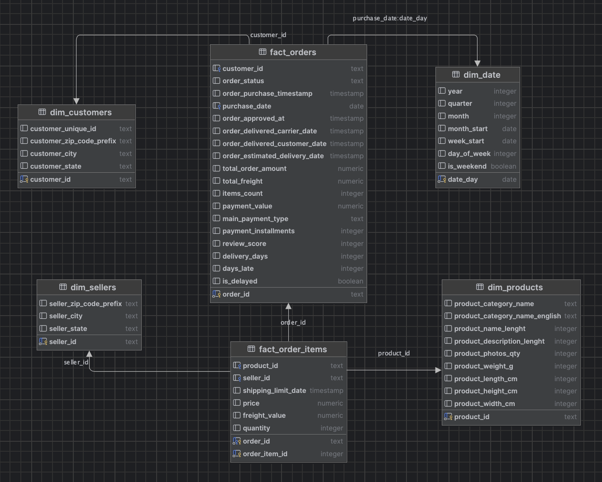
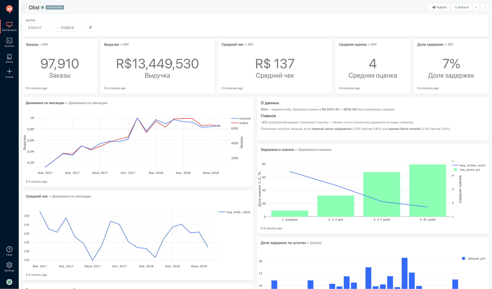

# Olist: хранилище данных, дашборд и анализ повторных покупок

## Описание проекта

Проект на открытом датасете [Brazilian E-Commerce (Olist)](https://www.kaggle.com/datasets/olistbr/brazilian-ecommerce).

В проекте:
- загрузка и проверка качества данных;
- хранилище по схеме «звезда»;
- слой витрин для дашборда;
- дашборд в Redash;
- анализ повторных покупок в SQL;
- проверка гипотез в Python.

---

## Используемые технологии

- PostgreSQL
- SQL
- Redash
- Python (pandas, numpy, scipy, matplotlib)
- Git

---

## Слои данных

```
raw -> staging -> dwh -> mart -> Redash
```

- `raw` — данные из CSV как есть;
- `staging` — приведение типов и проверки качества;
- `dwh` — факты и измерения;
- `mart` — витрины для дашборда;
- Redash — дашборд, читает только из `mart`.

---

## Модель данных



### Fact tables

- `fact_orders` — один заказ: статус, даты, суммы товаров и доставки, оплата, оценка, срок доставки и опоздание;
- `fact_order_items` — одна позиция заказа.

### Dimension tables

- `dim_customers`
- `dim_products` — с английским названием категории
- `dim_sellers`
- `dim_date` — календарь

*товары, платежи и отзывы агрегируются до соединения с заказами, чтобы суммы не задваивались
*задержка считается по датам, а не по времени: обещанная дата хранится как 00:00
*покупатель — `customer_unique_id`, потому что `customer_id` в Olist свой у каждого заказа

---

## Проверка качества данных

- дубликаты, первичные ключи, NULL, отрицательные значения;
- корректность дат и ссылочная целостность;
- совпадение числа заказов и выручки в `dwh` с источником;
- сверка витрин с `dwh` и между собой.

Найдено:
- 1 359 заказов переданы перевозчику раньше подтверждения;
- 23 заказа получены раньше передачи перевозчику;
- заказы без товаров.

---

## Витрины

| Витрина | Одна строка | Вопрос |
|---|---|---|
| `daily_sales` | день | как меняются продажи |
| `daily_sales_by_state` | день × штат | где растут продажи и где проблемы с доставкой |
| `daily_category_sales` | день × категория | какие категории приносят выручку |
| `reviews_by_delay` | день × группа опоздания | как опоздание связано с оценкой |
| `seller_performance` | продавец | какие продавцы важны и у кого проблемы |
| `customer_cohorts` | когорта × месяц | делают ли покупатели повторные покупки |

*в витринах только суммы и количества, средний чек и доли считаются в дашборде после выбора периода
*витрины — materialized views, данные загружаются один раз
*не учитываем отменённые заказы, период 2017-01 — 2018-08

---

## Дашборд



Запросы виджетов — `sql/9_dashboard_queries.sql`.

---

## Анализ в SQL

`sql/6_analytics.sql` — запросы по отдельным заказам и покупателям, после каждого записан вывод:
- повторная покупка в зависимости от доставки и оценки первого заказа;
- время до второй покупки;
- зависимость выручки от крупных заказов;
- что связано с низкой оценкой;
- этапы доставки;
- категории с худшими оценками;
- рассрочка.

*повторная покупка — заказ в более поздний день. 30% вторых заказов сделаны в тот же день, что и первый, это разбитая корзина, а не повторная покупка

---

## Анализ в Python

`notebooks/olist_analysis.ipynb`:
- повторная покупка на pandas, результат совпадает с SQL;
- z-тест: задержка первого заказа и повторная покупка, p = 0.0009;
- A/A-тест: 4.3% значимых тестов при α = 0.05, тест работает корректно;
- размер выборки для A/B-теста: ~19 тыс. покупателей в группе, около 9 месяцев набора.

---

## Выводы

- повторную покупку делают только 2.17% покупателей;
- заказы от нескольких продавцов получают низкую оценку в 47% случаев, от одного продавца — в 21%, заказы из одного товара — в 7.6% (только доставленные вовремя);
- если первый заказ задержали, повторную покупку делают реже: 1.99% против 2.94% (разница значима, p = 0.0009);
- после плохой оценки первого заказа повторных покупок тоже меньше: 2.23% против 3.04%;
- дольше всего заказ находится у перевозчика: медиана 7.1 дня;
- между штатами доставка вдвое дольше и задержки вдвое чаще;
- 10% самых дорогих заказов дают 41% выручки;
- A/B-тест на доле повторных покупок занял бы больше 9 месяцев, для экспериментов лучше брать другую метрику.

*это корреляции, а не доказанные причины

---

## Структура проекта

```
olist_dwh/
├── sql/
│   ├── 1_create_database.sql
│   ├── 2_raw.sql
│   ├── 3_staging.sql
│   ├── 4_quality_check.sql
│   ├── 5_dwh.sql
│   ├── 6_analytics.sql
│   ├── 7_mart.sql
│   ├── 8_mart_checks.sql
│   └── 9_dashboard_queries.sql
├── notebooks/
│   └── olist_analysis.ipynb
├── images/
└── README.md
```

---

## Как использовать

1. Скачать датасет с Kaggle.
2. Выполнить `1_create_database.sql` и подключиться к базе `olist_dwh`.
3. Указать путь к CSV в `2_raw.sql` и выполнить скрипты `2`–`8` по порядку.
4. Подключить базу к Redash и создать запросы из `9_dashboard_queries.sql`.
5. Для ноутбука установить `pandas numpy scipy matplotlib sqlalchemy psycopg2-binary ipykernel`.
